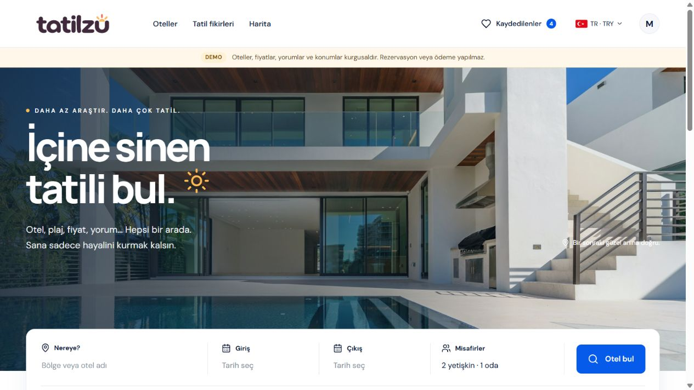
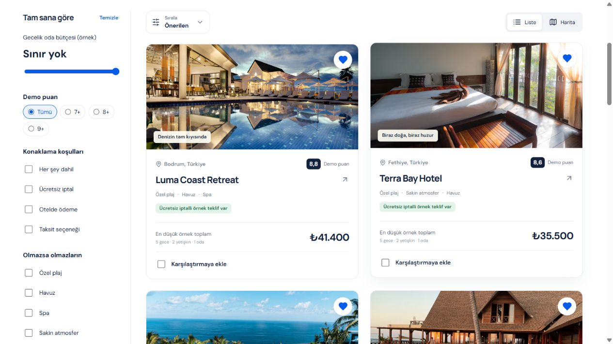
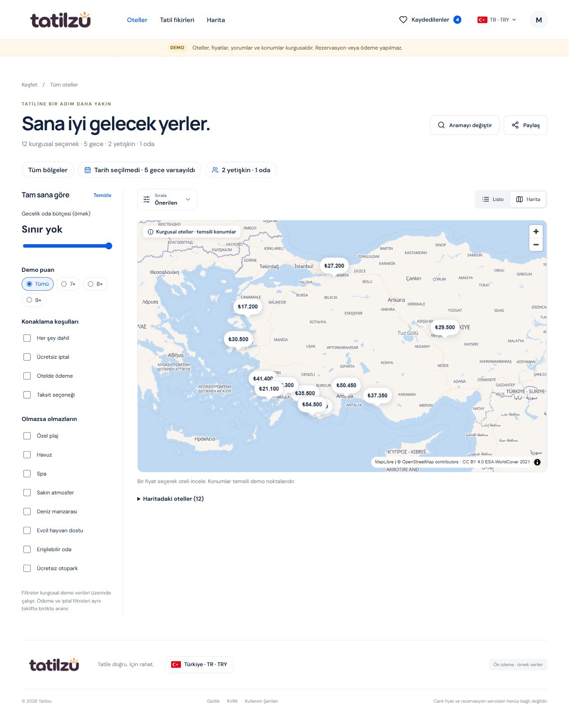
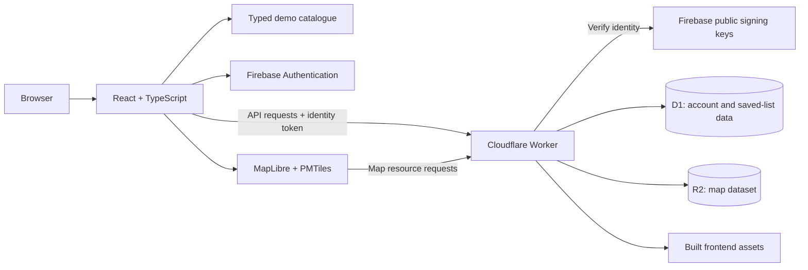

# Tatilzu
A hotel discovery demo for comparing beach access, amenities and cancellation terms before choosing a place to stay. Built with fictional hotels and offers.

[Explore the live demo](https://tatilzu.com) · [Architecture](docs/architecture.md) · [Türkçe](README.tr.md)

**React · TypeScript · Cloudflare Workers · D1 · R2 · Firebase Auth · MapLibre**

## Why I built it

Choosing a hotel means balancing location, atmosphere, price and cancellation terms across many tabs. Tatilzu explores a more focused experience: discover suitable options, inspect the full trip context, compare a shortlist and return to saved choices.

Built by **[Muhammet Rezan İçgil](https://github.com/rezanicgil)** as a personal product and engineering project, spanning the React interface, TypeScript domain logic and a Cloudflare-backed API.

> **Public product showcase.** Application source code remains private. The live experience uses fictional hotels, illustrative prices, reviews and locations. It does not provide live availability, reservations or payments.

## Try a search

Open the [Antalya results](https://tatilzu.com/oteller?q=Antalya). With no travel dates selected, the page shows its five-night assumption next to the example total. Switch from list to map, select Sol Garden Resort, and open its hotel card. The map marker identifies its location as illustrative. The hotel card links the total to the guest and room counts used in the search.

## Explore the product

| Experience | What it demonstrates |
| --- | --- |
| Search and refine | Destination, dates and guests combined with budget, amenities, score and offer conditions. |
| Compare with context | Up to three hotels side by side; trip-aware totals and offer breakdowns. |
| Explore geographically | List/map switching, synchronized selections and clear map attribution. |
| Save and revisit | Sign-in-backed saved lists and shareable research links. |
| Browse in two languages | Turkish and English interfaces, with TRY/USD display preferences. |
| Handle the edges | Loading, empty and failure states; keyboard interaction and reduced-motion support. |

### Discovery that stays readable

Filters and hotel cards keep the important trade-offs visible. Payment and cancellation conditions must match within the same offer, rather than accidentally combining unrelated offers.

### The same search, on a map

The map adds geographic context without creating a separate search experience. Real map tiles provide the geography; hotel positions remain illustrative demo coordinates.

## Engineering at a glance

| Layer | Technology | Responsibility |
| --- | --- | --- |
| Interface | React, TypeScript, Vite | Responsive screens, routing and interaction. |
| Domain | Typed catalogue and pure transformations | Filtering, offer matching, comparison and deterministic demo totals. |
| API and hosting | Cloudflare Workers | Asset serving, API routing, metadata and account operations. |
| Persistence | Cloudflare D1 | Account and saved-list records, separate from frontend fixtures. |
| Maps | MapLibre GL, PMTiles, Cloudflare R2 | Map rendering and dataset delivery. |
| Identity | Firebase Authentication, JOSE | Client sign-in and server-side identity-token verification. |

Read the [architecture and trade-offs](docs/architecture.md) for data boundaries, reliability considerations and the path beyond the demo.

## Decisions worth highlighting

- **Keep demo and live data separate.** Fictional catalogue entries are not presented as supplier inventory or imported into production account storage.
- **Keep identity checks on the server.** A client sign-in state alone does not authorize saved-list API operations.
- **Make research shareable.** URLs preserve relevant trip context without copying unrelated application state.
- **Load maps when needed.** The map renderer is lazy-loaded, with explicit loading and failure states.
- **Treat correctness as a product feature.** Regression tests cover domain calculations, routing, sharing, authentication and Worker behavior. This showcase does not claim a benchmark, coverage percentage or load-test result.

## Current scope and next steps

The public demo demonstrates the discovery workflow. Live supplier inventory, booking/payment flows and verified property data require separate integrations and validation. AI-assisted research is an exploration area, not a capability claimed by these screenshots.

The next engineering milestones are validating provider data/licensing, expanding observability and testing performance under representative traffic. A serverless deployment is not, by itself, evidence of unlimited scalability.

## About this repository

This repository contains the product story, screenshots and a high-level architecture overview. It is not a runnable application distribution. Screenshots were captured from the live demo on **29 October 2026**; the product may change afterward.

Product imagery includes third-party stock photography shown inside the application. Screenshots do not identify real hotel inventory or grant separate rights to underlying photographs. No open-source license for the private application is granted by this showcase.

**Built by Rezan** · [GitHub](https://github.com/rezanicgil) · [LinkedIn](https://www.linkedin.com/in/rezanicgil/) · [Portfolio](https://rezan.dev)
