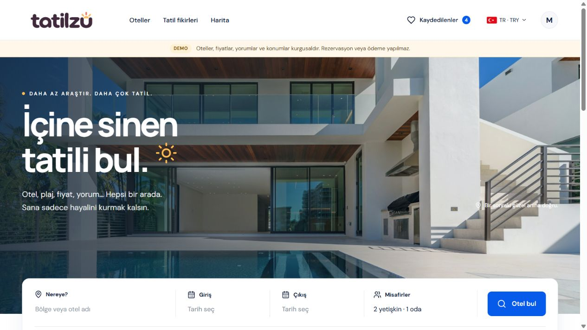
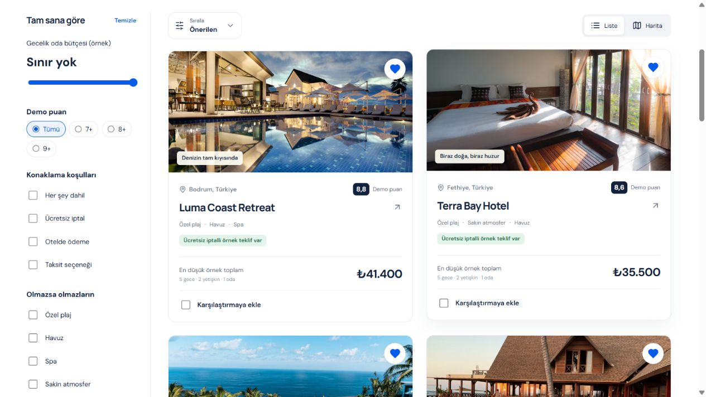

# Tatilzu

### Daha az araştır. Daha iyi tatil kararları ver.

[Canlı demoyu keşfet](https://tatilzu.com) · [English](README.md) · [Mimari özeti](docs/architecture.md)

Tatilzu; otel arama, filtreleme, harita ve karşılaştırmayı aynı araştırma akışında birleştiren kişisel ürün projem. Amacım, konumdan iptal koşullarına kadar karar vermeyi etkileyen bilgileri anlaşılır biçimde bir araya getirmek.

## Ürün deneyimi

- Bölge, tarih ve misafir bilgileriyle arama; bütçe, olanak ve konaklama koşullarıyla filtreleme.
- En fazla üç oteli karşılaştırma; seyahat bağlamına göre örnek toplamları inceleme.
- Liste ve harita arasında geçiş; seçili otel ve harita işaretlerinin birlikte çalışması.
- Hesapla kaydedilen listeler ve paylaşılabilir araştırma bağlantıları.
- Türkçe/İngilizce arayüz ve TRY/USD gösterim tercihleri.

**Bu bir ürün demosudur.** Oteller, fiyatlar, yorumlar ve otel konumları kurgusaldır. Canlı müsaitlik, rezervasyon ve ödeme sunulmaz. Gerçek harita coğrafyası, demo otel koordinatlarından ayrı değerlendirilmelidir.

## Teknik yapı

| Alan | Teknolojiler |
| --- | --- |
| Arayüz | React, TypeScript, Vite |
| API ve barındırma | Cloudflare Workers |
| Kalıcı veri | Cloudflare D1 |
| Harita | MapLibre GL, PMTiles, Cloudflare R2 |
| Kimlik doğrulama | Firebase Authentication, JOSE |

Frontend'deki tipli demo kataloğu; hesap ve kaydedilen liste verilerinden ayrı tutulur. Worker, kimlik belirteçlerini sunucuda doğrular. Harita ihtiyaç duyulduğunda yüklenir. Test kapsamındaki alanlar arasında filtreler, fiyat hesapları, yönlendirme, paylaşım, kimlik doğrulama ve Worker davranışları bulunur; burada ölçülmüş performans veya test kapsama oranı iddiası sunulmaz.

## Bu repoda neler var?

Bu repo; ürün tanıtımı, 29 Ekim 2026 tarihinde alınmış ekran görüntüleri ve [mimari karar özetini](docs/architecture.md) içerir. Uygulamanın kaynak kodu private kalır. Bu repo çalıştırılabilir uygulama dağıtımı değildir.

Ekranlardaki stok fotoğraflar gerçek otel envanteri olarak sunulmaz; bu repo alttaki fotoğraflar için ayrıca kullanım hakkı sağlamaz. Canlı veri sağlayıcıları ve AI destekli araştırma, ayrıca doğrulanması gereken geliştirme alanlarıdır.

**Muhammet Rezan İçgil** · [GitHub](https://github.com/rezanicgil) · [LinkedIn](https://www.linkedin.com/in/rezanicgil/) · [rezan.dev](https://rezan.dev)
